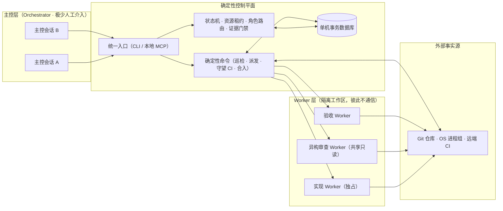
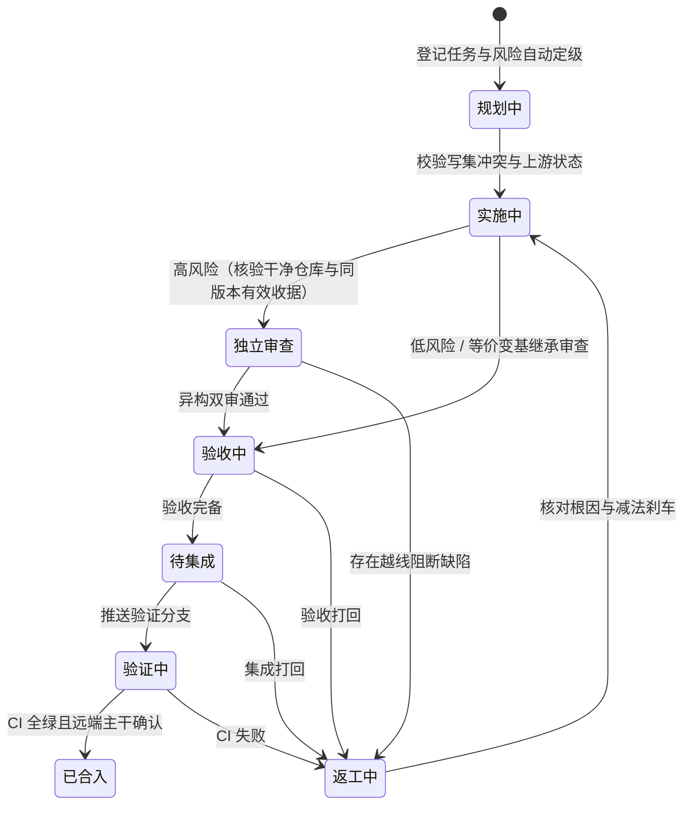

很多人第一次同时开多个 AI 写代码，都会遇到一件反直觉的事：模型明明越来越聪明，单个窗口已经能独立完成复杂重构，可一旦同时开两三个会话并行干活，效率往往不升反降，反倒天天忙着收拾现场。

表面看，这像是模型协作能力还不够强。但在真实项目里跑过一段时间后，我得出了相反的结论：模型会不断收回与推理有关的工作，但不会接管一个软件系统对外部世界承担的责任。

我是独立开发者，正在用 Rust 开发一套可视化节点式的量化工作流系统。底层由工作流引擎 Graphflow 和交易核心引擎 Nautilus 两个引擎协同驱动，上层包含服务端与前端画布。这类项目的特点很明确：Rust 的编译与全量测试很吃机器资源，双引擎与前后端之间的契约紧密耦合，又涉及资金与订单状态，容错空间很小。

一个人同时维护整套系统，我用 AI 写代码先后走过了三个阶段。

最初是单窗口串行。设计、实现、审查、验收、等待十几分钟 CI、合入主干，完整走完一个任务，才敢开始下一个。这样做最安全，但效率被锁在单线程里，而且每一步都需要开发者盯着衔接。

为了打破串行瓶颈，我切到了业界常见的 Orchestrator-Workers 模式（也常被称为 Supervisor-Worker，中文里可以理解为「主控—执行者」）。由主控会话跟我对齐目标、拆任务、派发简报和做裁决，由多个 Worker 各自负责实现、独立审查或验收；有时还会同时开两个主控会话推进不同主线。

但这个阶段没有独立的控制平面，所有协作规则都写在项目文档和提示词里。

分工确实比单窗口强了不少，并行度一上去，新的问题却集中冒了出来：两个 Worker 进到同一个目录互相覆盖改动；两份 `cargo test` 同时跑把机器内存打满；Worker 在总结里写着「测试全部通过」，实际上过滤条件写错只跑了 `0` 条用例；审查与返工来回拉锯五六轮，代码越改越重；原本想靠 AI 省出精力做产品，结果每天大量时间花在查分支、看进程、刷 CI 和盯着合入。

回头看，这些故障有一个共同点：它们都不是模型不够聪明导致的。

问题在于，我试图用自然语言约定去维持一个并发系统的工程不变量。提示词可以指导模型如何拆任务、写代码，但无法保证目录互斥、算力限流、证据真实和崩溃恢复。真正把这套并行流程稳住的，不是更新的 Prompt 技巧，而是几十年来在操作系统、数据库和分布式系统里反复验证过的老办法——读写锁、信号量、乐观锁、幂等回执、进程组回收与参照模型对拍。

我在主控和 Worker 之间补上了一层轻量的确定性控制平面。

这件事带来的最大变化，并不只是「并行不冲突了」，而是整条研发链路变成了高度全自动的闭环。我只需要给出目标，并在极少数关键节点拍板；至于拆单、按任务性质自动匹配合适模型、自动申请工作区与编译配额、自动调用确定性命令完成派发、校验收据、后台守望 CI、合入主干与清理分支，全部由主控通过控制平面自动推进，开发者介入的环节极少。

上线之后，这套系统在项目里平稳跑过了几十个任务、两百多轮派发与审查、近千次状态操作。下面记录这层控制平面的设计思路、几个关键边界、真实的代价与对照，以及何时不需要引入它。

<!--more-->

## 为什么选 Orchestrator-Workers，而不是 Agent 群聊

谈到多 AI 并行，很多框架习惯模拟人类团队：设计一张网状角色图，让规划者、执行者、审查者彼此发消息、自由讨论、多轮反思。

落到真实代码仓库里，这种网状对话有两个明显问题。

第一，上下文在多个角色之间反复转述后会逐渐失真，出了问题也说不清由谁负责。第二，这类编排本质上是在替当代模型补足规划与反思能力，模型升级之后，这些脚手架很容易失效，甚至妨碍新模型发挥。

我最后收敛出来的结构简单得多，只有三层，并且 Worker 之间不互相通信：

- 主控（Orchestrator）：与开发者对齐目标、做设计取舍、拆分清晰的任务简报，并自动调用控制平面命令推进整个任务流转与裁决。
- Worker（执行者）：接收一份独立简报，专注完成单一职责（写实现、独立审查或验收），交付产物后即结束。
- 控制平面（确定性层）：不参与任何推理，只负责维护外部世界的工程规矩——工作区归属、编译配额、写集隔离、角色模型映射、证据门禁、崩溃恢复与主干合入。

这种切分顺带解决了一个很实际的问题：上下文隔离。海量编译报错、代码翻查和反复试错全部消化在 Worker 的短生命周期会话里，主控只接收结构化结论与证据摘要，因此能同时管住多个并行任务而不被日志撑爆。同样因为全局状态保存在控制平面而非聊天记忆里，主控会话即使触发上下文压缩、重启，甚至换成另一个客户端接手，只要自动执行一条状态命令并扫一眼极短的交接页，几秒钟就能准确恢复现场。

在这三层之上，开发者与 AI 的决策边界也划得很清楚。可逆的工程推进——方案落地、局部重构、测试修复、常规返工与合入——全部由主控和 Worker 自动跑通，无需开发者一步步批准。只有遇到改变用户可见行为的产品口径（特别是资金、风控、延迟或降级策略）、真实外部写入、生产部署，或者超过收敛上限的重大取舍时，系统才会显式挂起当前任务等待开发者拍板，同时不阻塞其他独立任务继续自动推进。



实现这一层不需要重型工作流引擎。我只用脚本语言标准库加一个本机嵌入式关系型数据库保存全局状态，对外同时提供命令行和轻量本地 MCP 接口。这样无论开几个主控会话，还是更换不同客户端，执行的都是同一套约束。

并发底座只守住两条数据库基本功。其一是乐观锁加幂等回执：每次状态变更都携带归属者、预期版本号和操作编号，同号重试直接返回原结果，双主控并发冲突立刻拒绝，避免静默覆盖。其二是事务外做网络 I/O、事务内做现场复核：查询远端 CI 或拉取分支都在数据库锁外完成，拿到结果再进入短事务复核版本与工作区，避免慢网络阻塞其他并行任务。

## 不同模型做不同的任务：自动按角色分模型、分档位、分权限

把角色拆成主控与多类 Worker 之后，一个很自然的红利就出现了：不必从头到尾只用同一个模型、同一档推理预算和同一套权限，更不必靠开发者每次手工切换。

真实研发里，不同环节对模型能力的要求差别很大：

| 任务类型 | 侧重能力 | 自动匹配的推理与权限 |
| --- | --- | --- |
| 方案设计与架构权衡 | 全局视野、边界推演与取舍 | 高推理档位，只读沙箱，禁止改源码 |
| 代码实现与调试 | 工程执行、工具调用与多文件修改 | 按任务风险自动分级（小改动用中等档位换速度，复杂或高风险改动用高档位），独占工作区写权限 |
| 独立代码审查与仲裁 | 发现隐藏假设与边界缺陷 | 自动选用不同系列的异构模型并行审阅，只读沙箱，禁止续接实现会话 |
| 端到端界面验收 | 视觉理解与真实浏览器操作 | 擅长交互与视觉的模型，可操作隔离测试环境，隔离源码修改 |

这里最有价值的一点，是异构审查与动态档位。单一模型往往有固定的思维盲区，用同一模型自写自审，很容易顺着原思路把缺陷漏过去；自动调度不同系列的模型交叉审阅，或在返工陷入分歧时做独立仲裁，检出真实问题的概率会明显提高。而在低风险小任务上自动下调推理档位，又能把预算和等待时间留给真正复杂的模块。

所有映射关系都固化在控制平面的角色配置表里。主控发起派发时只需声明任务风险和角色，系统自动选择对应的模型、推理档位与沙箱边界——既免去了人工选型和反复传参的负担，也从机制上防止只读角色越权修改代码。

## 把并发拆回三个老问题：工作区、编译配额、写集

从单线串行切向并行时，最容易走入两个极端。怕冲突就加一把粗粒度锁，结果退回「做完一个才能开下一个」的老路；如果每个任务临时新建工作区，Rust 每次全量冷编译，等待成本反而更高。

换用操作系统的资源调度视角看，并行开发里其实混着三种不同的冲突，需要拆成三个正交维度分别管理。

第一类是工作区冲突，对应读写锁（RWLock）。在主仓库旁边维护两三个固定复用的隔离工作区，各自保留增量编译缓存。写代码的实现 Worker 独占工作区；多个只读审查 Worker 则可以共享同一个候选工作区并行审阅。新的写任务进入之前，必须等待正在读取该工作区的所有审查结束。

第二类是算力冲突，对应信号量（Semaphore）。一台开发机同时挂三个工作区并无压力（例如一个在编译、一个在审查、一个在等待 CI），但同时运行三份全量构建与测试就会把机器拖垮。把「编译配额」从「工作区」拆出来后，只有触发构建和测试的实现阶段，才在同一个事务里同时申请工作区和编译配额——要么全部拿到，要么整体回滚，不占着工作区干等算力。单轮构建结束，编译配额立刻自动归还给下一个任务，工作区则继续保留到审查、验收和合入完成。审查、页面验收和等待 CI 都不消耗编译配额。

第三类是逻辑代码冲突，对应范围锁（写集隔离）。物理目录隔开了，两个看似独立的任务仍可能改到同一批源码，各自测完才在合入时冲突。因此登记任务时必须声明预期改动路径。只要任务尚未结束，哪怕还未拿到工作区，同仓库里其他非上下游任务就不能声明与之重叠的路径。这样就把合并冲突从「写完之后」前移到了「开工之前」。

落地时，一张数据库资源表就能统一管理工作区与编译配额的租约，同时预留外部占用登记口，兼容临时手动调试；写集比对在开工和增量扩展范围时自动执行，并兼顾不同操作系统的路径大小写语义。

## 证据与收敛：不信自报，也不让审查无休止

并行派发跑通之后，我先后遇到两类看似相反、实则同源的失效现场。

第一类是「假通过」。有一次，实现 Worker 在收尾报告里写得条理清晰：问题已修复，全套测试通过。我顺手检查了原始日志——命令退出码确实是 `0`，但它写错了测试过滤名，实际执行了 `0` 条用例。另一次，审查会话续接了前面的实现上下文，在同一个视角下顺手完成了「独立审查」，直接放过了一处边界缺陷。

在涉及资金、订单和双引擎协作的项目里，不能靠提示词要求模型诚实汇报，也不能靠开发者每次手动抽查。模型负责干活，外部事实负责盖章，控制平面自动做核验。

具体的硬底线有四条：

- 按风险自动分道。界面文案等低风险改动走快速通道，本地验证后直接进入 CI；一旦改动触及并发、状态机、生命周期或资金结算，建单时由规则自动升格为严格通道，强制要求前置设计、仿真验证与独立审查。
- 三要素硬收据。提交候选版本时，控制平面直接检查仓库现场：工作区必须干净、全部改动落在声明写集内，测试与检查收据必须同时满足三项条件——绑定当前提交号、退出码为 `0`、实际执行用例数大于 `0`。
- 真独立审查。高风险改动自动并行派发两个不同模型的审查 Worker，系统禁止审查续接历史会话，并直接从运行日志头解析真实会话 ID，校验实现与两路审查三方互不相同。
- 安全叠栈与等价继承。如果任务 B 强依赖任务 A，A 通过本地审查后 B 即可基于已审版本先行开工，不必干等十几分钟 CI；合入前由控制平面核对实际进入主干的提交归属，防止崩溃残留或未审代码被夹带。如果已审候选只是同步主干做了一次内容等价的变基，验明改动未变后自动继承原有审查结论，不必重复重审。

第二类失效恰恰相反：补上严格审查之后，流程开始「收不住尾」。

只要继续向审查 Worker 提问「还有没有可以改进的地方」，它几乎总能找出新的意见——命名可以更贴切、抽象可以再抽一层、某个罕见分支可以再包一层。模型天然擅长做加法，不会自己停手。一个中等任务很容易在审查与返工间拉锯四五轮，为了最后几分的洁癖，把原本清晰的实现改出新缺陷。

治住这种失控，同样靠自动生效的硬刹车：

- 二维阻断红线。按「严重度 × 发生频率」划清边界。跨过红线的阻断缺陷必须修复；低优先级改进允许记录为后续跟踪项直接放行，控制平面同时拦截将高危缺陷塞入延后清单的操作。
- 返工上限与减法裁决。每条必须修的问题都要明确能否沉淀为测试或门禁；一旦自动返工达到两轮或待修项过多，禁止继续打补丁，必须在返工简报里先给出「减法裁决」——明确说明要删掉哪些复杂逻辑、如何收窄范围。若仍未收敛，系统自动转入第三方独立审查仲裁；只有确认涉及核心产品取舍时，才挂起任务、释放工作区交回给开发者。
- 交接文档上限与历史决策召回。状态交接页用固定注释围栏分成两块：围栏内由命令自动刷新当前工作区与活跃任务，围栏外只保留极少数待决事项，整页设行数硬限，超限即归档旧流水。散落在本地的历史决策笔记不靠全量灌入提示词，建单时由控制平面按声明路径与关键词自动轻量匹配，顺手把最相关的几条带进上下文。
- 周期性跨模块体检。多任务并行有一个隐蔽副作用：每个任务在自己的写集里看起来都完全正确，但连续合入十几笔之后，全仓仍可能悄悄长出重复实现、边界漂移与过时规则。控制平面维护一条只读巡检基线，满一定周期（例如七天）、累计一定数量的主干提交或关键里程碑合入后自动提醒做一次跨模块体检；体检不阻塞日常合入，新立的试行规则也设生命周期，跑完一个里程碑未转正即删除，防止规范只增不减。



落地时，状态表结构化保存每个任务的阶段、候选提交号与凭证；每轮 Worker 独立归档日志、产出与提交范围，下一阶段直接拿真实仓库和归档文件自动对账。

## 通过命令执行确定性的任务：别让模型即兴拼指令

还有一条非常省心、也最容易被低估的原则：凡是目标明确、步骤固定、容错率低的动作，都应该封装成确定性命令，由主控自动调用，而不是让模型即兴拼接一长串底层 Shell 指令，更不需要开发者手工去敲。

让我彻底下定决心的，是两个很具体的事故现场。

一次推送之后，某条核心门禁失败，CI 平台自动取消了另外三条仍在运行的门禁。如果只观察最先退出的任务，主控就会顺着一条被连带标记为 `cancelled` 的日志排查半天，完全偏离真正的失败原因。

另一次，实现 Worker 的主进程已经退出，但它在后台拉起的 `cargo` 子进程仍在往目录里写文件。如果此时直接释放工作区，下一个任务进入后立刻就会和滞留进程互相踩踏。

把这类问题往外推一层就会发现，模型最容易失手的地方，往往不是设计或写代码，而是临场拼装一连串带副作用的命令——漏掉一个防覆盖参数、忘查一次远端分叉、在半失败状态下留下脏现场，或者反复跑七八条零散查询把上下文撑满终端噪音。

因此，我把整条流水线上所有确定性动作，全部收拢成一组带参数校验和幂等回执的命令，同时暴露为 CLI 与本地 MCP 工具供主控自动调用：

- 现场巡检与交接刷新。一条状态命令一次性汇总工作区、活跃进程、租约、远端 CI 与下一步建议，交接页也由命令加锁自动刷新。
- 统一派发与进程组回收。派发命令自动完成简报校验、租约抢占、角色模型与沙箱匹配和独立进程组启动；主进程退出后确认整个进程组彻底排空再归还编译配额，若中途强杀或断电，只要工作区脏或留有未推送提交，系统保守保留现场等待核查，绝不自动清理导致代码丢失。
- 事件驱动守望 CI。后台自动挂载确定性守望命令，区分真实失败与连带取消，也区分网络抖动与构建失败；只在终态到达时自动唤醒主控，并在审查门禁结束时把审查报告摘要拉回本地，告别定时轮询刷屏。
- 确定性变基、合批验证与一键原子合入。对于全量 CI 耗时十几二十分钟的项目，每个小改动单独跑一轮完整 CI 过于昂贵。控制平面支持把多个已验收的独立改动或叠栈改动按线性历史打包成同一个验证批次，只跑一次完整 CI；全绿后，由一条幂等合入命令自动校验远端未分叉、扫描本地文件无冲突、快进主干、推送失败自动回滚、读回确认、按严格祖先关系清理已合入的验证分支并一次性批量结单，几秒完成，省掉一整轮 AI 合入会话。

把动作封装成命令后，模型只负责决定「什么时候调用、传哪几个参数」，所有前置校验、锁保护与失败回滚都锁在确定性代码里。哪怕主控误判时机发起调用，命令也会直接拒绝并返回结构化原因，同时把原本几千字的终端输出压缩成一小段干净的结果。

把前面所有机制串在一起，一段 20 分钟左右的全自动并行开发大致是这样运转的：

```text
t=00m  开发者确认本轮目标后退场；主控自动派发任务 A（引擎改动）占工作区 1 + 编译配额 1，
       同步派发任务 B（前端画布）占工作区 2 + 编译配额 2，各自匹配对应模型与沙箱开始实现
t=08m  任务 A 实现完成并自动通过收据核验 → 立刻归还编译配额 1 → 自动并行启动两路异构审查共享工作区 1
       主控发现编译配额 1 空出 → 自动派发任务 C（独立修复）占工作区 3 + 编译配额 1 开工
t=12m  任务 A 审查通过并完成验收 → 自动与任务 B 线性合批推送验证分支，挂后台命令守望 CI
       任务 A 的强依赖下游 D 不必干等 CI，基于 A 的已审版本提前叠栈开工
t=26m  CI 全绿自动唤醒主控 → 自动调用一键合入命令完成快进主干、清理验证分支与批量结单
```

这二十多分钟里，除了开头对齐目标和少数涉及产品口径的确认，开发者几乎不需要碰分支、选模型、看终端或催进度。

## 像测并发系统一样测控制平面

做到这一步，往往还会遇到另一个现实问题：很多人自己写过类似的派发脚本，但跑不了几周就会因为隐蔽 bug 被弃用。

原因并不神秘。这类工具写起来像胶水脚本，运行起来却是一个同时操作数据库、Git 仓库、操作系统进程与远端 API 的并发状态机。一旦它自身出现竞态、死锁或错误放行，放大的就是整条研发流水线的事故半径。

解决这个问题，我依然借用了并发系统与分布式数据库的验证思路——独立参照模型加随机交错仿真。

具体做法分两层。第一层是逻辑对拍：单独维护一份极简的纯内存参照模型，用直白逻辑把合法流转、资源约束与合入前提重述一遍，刻意不与生产代码共享实现；再用固定随机种子生成大量多任务并发交错序列，每走一步都同时驱动真实数据库、真实 Git 仓库与内存模型，逐字段比对快照。

第二层是真实故障注入：拉起真实多进程抢锁、在写事务中途强杀进程验证崩溃恢复与幂等重放、制造滞留后台子进程验证租约保护、构造分叉历史与脏工作区验证拦截逻辑。实战中每发现一个新边界，就直接固化为永久回归场景。

## 三个阶段的实际对照

把单窗口串行、没有控制平面的 Orchestrator-Workers，以及加上确定性控制平面三个阶段摆在一起，可以清楚看到变化分别来自哪里：

| 维度 | 阶段一：单窗口串行 | 阶段二：Orchestrator-Workers（无控制平面） | 阶段三：Orchestrator-Workers + 控制平面 |
| --- | --- | --- | --- |
| 自动化与人工介入 | 每一步都要开发者盯着衔接、催测试、看 CI 并手动合并 | 拆出了分工，但开发者变成全职调度员：不断选模型、核分支、查进程、盯 CI、防 Worker 报喜不报忧 | 拆单、选模型、抢资源、调命令、守望 CI、合入主干全自动闭环，开发者只介入目标确认与极少数高风险拍板 |
| 研发吞吐 | 完整跑完一个任务并等完十几分钟 CI 才敢开下一个，大量时间耗在等待上 | 开始尝试多任务并行，但容易互踩工作区或把机器编卡死，常被迫退回单线 | 审查、验收与等待 CI 的空档由第 2、第 3 个并行任务填满；强依赖任务本地审完即可叠栈开工，多任务还可线性合批共用一轮完整 CI |
| 模型与工具分工 | 单一模型包办全部环节，底层 Git 与测试命令全靠临场拼接 | 仍常靠人工切换模型或同模型自审，主控手工拼接多条 Shell 命令 | 自动按角色匹配异构模型、推理档位与沙箱权限；巡检、派发、守望与合入全由主控自动调用确定性命令 |
| 上下文与收尾成本 | 单窗口对话越拉越长，最终仍需人工盯 CI 与合入 | 主控定时轮询 CI 刷屏、换会话先读几百行交接流水，合入主干还需单独派一轮 AI | 海量日志隔离在 Worker 会话内，事件驱动终态唤醒，交接页极短且支持跨会话秒级接手；合入主干与清理分支一条命令几秒完成 |
| 返工与质量收敛 | 同一会话自写自审容易留盲区，大小改动混在一条长对话里 | 引入了独立审查，但常陷入四五轮细节拉锯；低风险小改动也跟着走重流程 | 快慢双轨自动分流，二维红线加两轮减法刹车让绝大多数任务在 1~2 轮内收口，并配周期性跨模块体检防漂移 |
| 并发安全 | 串行最安全，几乎没有并发冲突 | Worker 崩溃、后台子进程滞留或改重文件时，容易丢改动或夹带未审提交 | 上线后平稳跑过几十个任务、两百多轮派发与近千次状态操作，未再出现并发覆写或误合入事故 |

对独立开发者而言，最稀缺的从来不是算力，而是自己的注意力和判断力。这套系统没有让单个模型一夜之间变聪明十倍，但它把整套研发流程变成了可以放心托付的自动化流水线，把一个人稳定驾驭多个并行 Worker 的上限实实在在地抬高了一截。

## 代价、适用边界与分步起步

这套做法并不是零成本的银弹，它有三个真实代价。

第一，控制平面本身是一套需要测试和维护的本地基础设施，初期搭建和持续补回归用例都要花精力。第二，写集声明与证据门禁会带来一定的前期约束摩擦，偶尔遇到跨模块改动漏报路径时需要增量扩展写集，因此必须同时保留快速通道和灵活扩范围的机制。第三，控制平面只能强制要求提供收据，不能凭空制造质量——前提依然是代码库本身具备可靠的测试、lint 与仿真基线。

因此，不要为了显得系统化而去搭建一层控制平面。如果项目体量不大、构建只需几秒钟、每天单窗口顺着做一个接一个完全够用，引入状态机和租约纯属过度工程。只有当你确实因为等待编译、审查或 CI 开始同时开两三个并行窗口，并且已经实际遭遇目录互相覆盖、编译打满机器、假通过、返工拉锯或人工盯场过累时，这层控制平面才值得投入。

即便到了这个阶段，也不必一次做成完整形态。按收益从高到低，可以分三步演进：

1. 先用半天落最值钱的一半：在主仓库旁边建立两三个固定复用的 `git worktree` 保留编译缓存，并把「现场巡检、统一派发、后台守望 CI、一键快进合入并清理分支」封装成确定性命令交给主控调用。这一步就能立刻大幅减少人工盯场与合入手滑。
2. 并行稳定后再补状态与边界：引入一张极简本地状态表（SQLite 即可），管住工作区与编译配额租约、开工前声明改动路径防冲突，并要求提交候选时必须提供同提交号、退出码为 `0` 且用例数大于 `0` 的测试收据。
3. 高频重度使用后再封顶：当开始常态化运行异构双审、按角色自动分模型与档位、多主控并发或叠栈合批开发时，再补上二维阻断红线、返工减法刹车、历史决策轻量召回、周期性跨模块体检，以及独立参照模型与故障注入回归测试。

---

模型更新得很快，许多教模型如何思考的提示词技巧与角色对话脚手架，迟早会被新一代模型吸收。但读写锁、信号量、乐观锁、零信任收据、进程组回收与参照模型对拍这些沉淀了数十年的系统工程办法，解决的是并发世界里的外部事实问题，不会随模型升级而过期。

一个人能同时调动的并行 Worker 越多，立在主控与 Worker 之间这层薄、硬、全自动运转的确定性控制平面，反而越重要。
